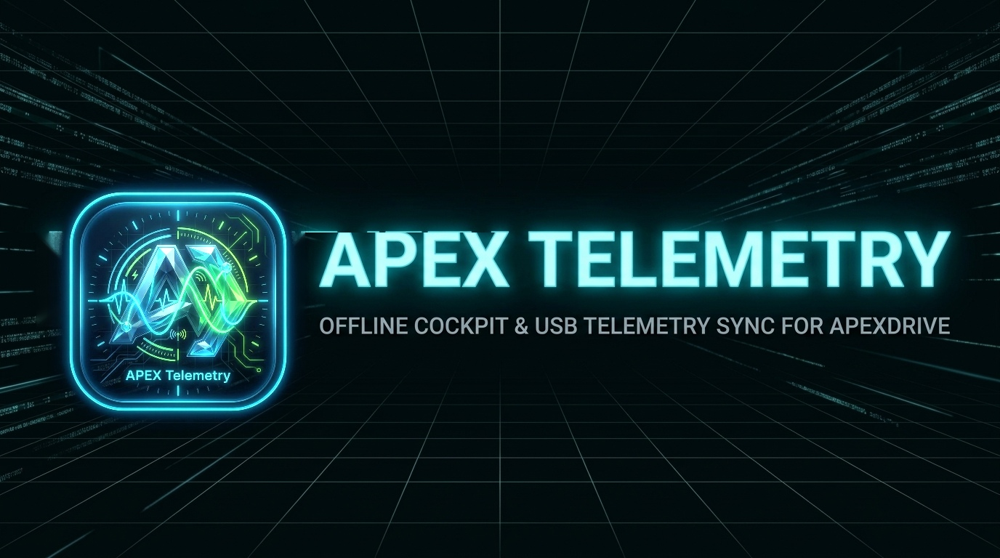

# Apex Telemetry

<div align="center">

### Local Telemetry Cockpit, GPS Route Viewer & USB Sync for ApexDrive

[](https://github.com)
[-0078D6.svg)](https://github.com)
[](LICENSE)
[](AI_DISCLOSURE.md)
[](PRIVACY.md)

</div>

---

## ⚡ Overview

**Apex Telemetry** is a desktop cockpit and analysis dashboard built with Electron, tailored specifically for processing electric bicycle telemetry CSV files exported by **ApexDrive**. CSV analysis works locally and offline; the optional map background uses online OpenStreetMap tiles.

It provides deep-dive analytics for ride performance, motor wattage vs. bio-mechanical rider effort, battery discharge curves, thermal profiles, and assist mode distribution. In addition, it integrates a non-destructive, read-only direct USB phone sync engine built on top of the native Windows Portable Devices (WPD) API—eliminating the need for ADB or developer mode.

---

## ☕ Support the Project

APEX TELEMETRY is provided **free of charge** (Freeware) for the e-bike community. There are no paywalls, in-app purchases, subscriptions, or ads.

If you enjoy the app and want to support ongoing development, optimizations, and new features, tips and donations are greatly appreciated!

| Platform | Link | Description |
| :--- | :--- | :--- |
| ☕ **Ko-fi** | [](https://ko-fi.com/j4ckp0t85) | Send a one-time tip or buy a coffee via [ko-fi.com/j4ckp0t85](https://ko-fi.com/j4ckp0t85) |
| 💳 **PayPal** | [](https://www.paypal.com/donate/?business=ZDARGHTS7LUDA&no_recurring=1&currency_code=EUR) | Direct donation via [PayPal (EUR)](https://www.paypal.com/donate/?business=ZDARGHTS7LUDA&no_recurring=1&currency_code=EUR) |

---

## 🌟 Key Features

### 📊 Comprehensive Telemetry Analytics
Turn raw ride recordings into clear, actionable insights:
* **Interactive Dual Charts**: Synchronized crosshairs and inspectable data points for Speed vs. Motor Power and thermal behavior.
* **Dual Power Metrics**: Compare electrical motor output directly against human bio-mechanical pedaling effort.
* **Battery Consumption**: Compare charge drops across selected sessions, reported in percentage points (pp). Sessions with charging or invalid battery readings are excluded and identified; the total can exceed 100 pp.
* **Single-Session Discharge Chart**: In a single-session view, inspect reported battery charge (%) over time when the session shows at least a 5 pp drop and has valid, uninterrupted readings.
* **Thermal Dynamics**: Monitor motor and controller operating temperatures throughout entire sessions.
* **Assist Mode Distribution**: Visual breakdown of assist mode usage across all your rides.
* **Flexible Filtering**: View aggregated data across all sessions, inspect custom date ranges, or zoom in on single rides.

### 🗺️ GPS Route & Linked Sample Inspection
The route map and sample slider are available only in **Single session** view. **All sessions** and **Date range** hide the entire GPS panel, even when an aggregate filter matches only one session.

* **Interactive Route Map**: An embedded Leaflet/OpenStreetMap map draws the ride in blue, with drag/keyboard panning, zoom, fit route and fullscreen controls. No API key, account or paid subscription is needed. The public tile service is best-effort and subject to its [usage policy](https://operations.osmfoundation.org/policies/tiles/).
* **Shared Sample Focus**: Hover any time-series chart or near the blue route to inspect the same original CSV sample across the map, speed/power, temperatures and eligible battery-discharge chart. The matching assist level is highlighted. Hovering an assist-distribution bar selects its first matching sample unless the current sample already belongs to that level; a distribution bar is an aggregate, not a unique time sample.
* **Visible Sample Details**: A compact readout beside the map shows the sample's speed, motor/rider power, cadence, motor/controller temperatures, reported battery charge, voltage, distance and assist level. It works in fullscreen and keeps the last inspected values visible after the pointer leaves the route. Missing readings appear as `—`; estimated or unavailable GPS positions are labeled. On narrow windows the readout moves below the map.
* **Precise Selection**: The sample slider also supports arrow keys and reaches every original row, including stationary or overlapping GPS fixes and rows omitted from chart downsampling. Map hover at overlapping fixes prefers the occurrence closest to the current focus.
* **Legacy CSV Support**: `GPS_Latitude` and `GPS_Longitude` are optional. Old 18-column files, current 20-column files, and sessions with no GPS still import and retain their telemetry charts. The map explains when valid coordinates are unavailable.
* **Conservative Off-Road Gaps**: Up to 10 missing samples are connected only when endpoints are within 15 seconds and 60 metres and movement is plausible. These straight-line estimates appear as dashed blue connections; focus labels identify estimated positions. Longer outages, implausible jumps and different sessions remain separate. Leading/trailing gaps are never extrapolated. This does not reconstruct the exact trail or snap rides to roads.
* **Offline Route Inspection**: Turn off **Online background** to keep inspecting local GPS geometry without tile requests. Missing or blocked tiles also leave the route and sample controls usable. The switch is retained for the current app window and defaults to enabled on the next launch; tiles are requested only when the selection has GPS.

Coordinate pairs containing empty cells, literal `null`, non-numeric/non-finite values or values outside latitude ±90° / longitude ±180° are treated as missing during folder import. A pair requires both values; valid zero coordinates are retained. USB sync accepts both supported headers, valid coordinates and null/empty GPS cells, while rejecting corrupt numeric coordinates and incorrect column counts before publication.

### 📱 Read-Only USB Phone Sync (No ADB Required)
* **Direct MTP / WPD Integration**: Discover and transfer ride CSV files directly from your connected Android phone via standard USB file transfer.
* **Non-Destructive & Safe**: Never modifies, overwrites, or deletes files on your phone or computer.
* **Duplicate Detection**: Only new, unimported sessions are transferred to your local telemetry workspace.

### 🌓 Clean, High-Contrast Cockpit Design
* **Adaptive Dark & Light Themes**: Seamlessly switch between dark and light themes with instant persistence.
* **Responsive Workspace**: Clean typography, status indicators, and drawer states with persisted window geometry.

### 🌍 Automatic Language Support
* **System Language**: 30 bundled dictionaries covering English, Italian, German, French, Spanish, Portuguese, Simplified and Traditional Chinese, Japanese, Korean, Hindi, Bengali, Tamil, Telugu, Marathi, Gujarati, Punjabi (Gurmukhi), Urdu, Arabic, Persian, Russian, Turkish, Indonesian, Malay, Vietnamese, Thai, Filipino, Swahili, Hausa and Amharic. The primary OS language selects the interface at startup, with English fallback for unavailable languages or scripts. Chinese regional variants select the appropriate script; Arabic, Persian and Urdu use a right-to-left workspace.
* **Local Dictionaries**: Dashboard text, USB sync guidance and known errors, native folder-dialog title, accessibility labels and the isolated GPS map use bundled dictionaries. No translation service or network connection is needed. Unknown operating-system diagnostics, filenames and CSV field names remain verbatim.
* **Source Meaning**: Dictionaries use stable `UPPER_SNAKE_CASE` labels (for example, `RIDE_OVERVIEW` and `SAMPLE_INDEX`); English dictionary values are the semantic reference. Values contain plain text and named interpolations, with grammatical plural forms. HTML, emphasis and decorative icons belong to the templates. Translations retain the distinction between reported charge and measured energy, recorded GPS and estimated positions, and percentage points (`pp`) versus percentages.
* **Release Checks**: `npm test` validates all 30 dictionaries, including plain text, coverage, placeholders, formatting and technical identifiers. `npm run test:ui` uses English for Electron integration checks, including language-loading fallback, sync, maps, themes and map-label fit. Both commands run in the Windows GitHub release workflow before packaging; fixture screenshots are uploaded as a separate verification artifact. Regional UI batches are available for optional manual translation review.

See [_INTERNALDOCS/multilanguage-support.md](_INTERNALDOCS/multilanguage-support.md) for the implementation batches and translation maintenance checklist.

---

## 🚀 Getting Started

### Installation
Official pre-compiled binaries are available under the repository's **Releases** tab:
* **ApexTelemetry-Setup-1.0.0.exe**: Standard Windows installer (NSIS) with customizable destination directory.
* **ApexTelemetry-Portable-1.0.0.exe**: Standalone portable executable requiring no installation.

### Quick Start
1. **Launch Apex Telemetry**: Open the application.
2. **Choose Telemetry Folder**: Navigate to **Import data** and choose a local folder where your ride CSV files are stored.
3. **Analyze Sessions**: Return to the **Overview** tab to explore aggregated statistics, metrics, and charts.
4. **Sync from Phone (Optional)**: Plug in your Android phone via USB, enable **File transfer (MTP)**, click **Find phone** under the USB sync panel, and press **Sync CSV files**.

### Example Telemetry

To explore the dashboard before importing your own rides, enable **Show example telemetry** under **Import data**, or use the same button on the empty Overview screen. The included CSV opens in the dedicated **Example telemetry** view, with charts, GPS route inspection and a visible example notice. No telemetry folder or phone is required.

The option is disabled by default and saved between launches. Once enabled, the **View** selector lets you switch between the example and your personal sessions. Turn the option off in **Import data** to hide the example and return to your personal view. The bundled example is never added to **All sessions**, date filters, personal session counts or USB sync destinations.

The example is the original recording `telemetry_session_20261010T121124177Z_d6959a1b-c6ae-46d0-8eca-1b3d34dea4f1.csv`, including its recorded GPS coordinates and missing first GPS fix. It is shipped with the app and read locally; the usual **Online background** map setting controls tile requests.

---

## 🔌 USB Phone Synchronization (Windows)

> **Platform Note:** Direct USB phone synchronization is currently implemented for **Windows** using the native Windows Portable Devices (WPD) API. On macOS and Linux, users can import CSV files copied locally to their filesystem.

### Android Setup Steps
1. Connect your Android phone to your PC using a standard USB data cable.
2. Unlock the device and select **File transfer / Android Auto** in the USB connection notification.
   *(Note: Charging-only and Photo transfer (PTP) modes will not allow access to the telemetry folder).*
3. Verify that **Internal storage** appears in Windows File Explorer.
4. In Apex Telemetry, navigate to **Import data**, click **Find phone**, and then select **Sync CSV files**.

### Troubleshooting USB Connectivity
* **Device shows a yellow exclamation mark in Device Manager**:  
  Right-click device $\rightarrow$ **Update driver** $\rightarrow$ **Browse my computer for drivers** $\rightarrow$ **Let me pick from a list of available drivers** $\rightarrow$ **Portable Devices** $\rightarrow$ select **MTP USB Device**.
* **Device disconnects or doesn't appear**: Verify you are using a high-quality USB data cable and a direct USB port (avoid unpowered USB hubs).

---

## 🛠️ Development & Building

### Prerequisites
* **Node.js**: v22.12.0 or later
* **Windows Build Tools**: Visual Studio C++ build environment (MSVC) for compiling the native WPD helper binary (`WpdReader.exe`)

### Setup & Run
```powershell
# Install dependencies
npm install

# Build the native WPD helper and launch the Electron application
npm start
```

### Packaging Binaries
```powershell
# Build Windows installer and portable executable
npm run dist:win

# Build Windows installer only
npm run dist:win:installer

# Build portable executable only
npm run dist:win:portable
```

---

## 🛡️ Privacy & Zero Data Collection

Apex Telemetry processes your telemetry locally:
* **No Developer Analytics**: The application does not contain remote analytics, error-reporting trackers, or remote telemetry collection.
* **Local CSV Processing**: Telemetry files, route geometry and sample values are not uploaded. Application preferences remain on your local machine.
* **Online Map Background**: When enabled, OpenStreetMap receives tile requests containing the viewed map area, your IP address and the application User-Agent. This can reveal the approximate ride location. Disable **Online background** to stop tile requests; local charts and route inspection continue to work.
* For full details, please refer to our [Privacy Policy](PRIVACY.md).

---

## 🤖 EU AI Act & Artificial Intelligence Transparency

In compliance with **Regulation (EU) 2024/1689 (European Union AI Act)**:
* **AI-Assisted Development**: Portions of the codebase, documentation, and structural optimizations for Apex Telemetry were developed with the assistance of Generative AI tools and LLMs under human review and testing.
* **Deterministic Analytics**: The runtime desktop application uses deterministic mathematical and statistical algorithms for parsing telemetry data without black-box neural networks or profiling systems.
* For the full compliance statement and risk categorization, see [AI_DISCLOSURE.md](AI_DISCLOSURE.md).

---

## ⚖️ Legal Disclaimer & Terms of Use

* **"AS IS" Warranty**: This software is provided free of charge on an "AS IS" basis without warranties of any kind.
* **Hardware & Data Safety**: While the USB synchronization engine operates in a non-destructive, read-only mode, the author accepts no liability for device issues, driver conflicts, or data loss.
* For complete terms, liability limitations, and indemnification, please review [DISCLAIMER.md](DISCLAIMER.md).

---

## 📄 License & Distribution Terms

Apex Telemetry is distributed as **Proprietary Freeware (All Rights Reserved)**.
* **Official Binaries**: Releases are provided exclusively as official installers and portable `.exe` packages via GitHub Releases.
* **Restrictions**: Reverse engineering, decompilation, unauthorized modification, or commercial monetization is strictly prohibited.
* For the complete End User License Agreement, see [LICENSE](LICENSE).
* Bundled Leaflet and OpenStreetMap attribution are documented in [Third-party notices](THIRD_PARTY_NOTICES.md).

---

## 🏷️ Keywords & Search Index

`#apexdrive` `#apextelemetry` `#electron` `#ebike` `#ebike-telemetry` `#tongsheng` `#tsdz2` `#varstrom` `#ekd01` `#wpd` `#windows-portable-devices` `#mtp` `#desktop-dashboard` `#offline-analytics`
